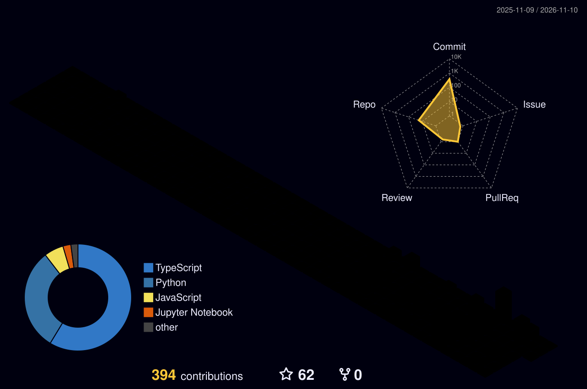

[+%40+NiT+Kolkata)](https://git.io/typing-svg)



[](https://www.linkedin.com/in/debarun-banerjee-b8524a37b/)
[](https://debarun.base44.app/)

---

```python
debarun = {
    "location"    : "Kolkata, West Bengal, India",
    "degree"      : "B.Tech CSE (AI & ML) @ Narula Institute of Technology",
    "year"        : "2nd Year",
    "building"    : ["HavensLight v2", "A new live fintech product"],
    "researching" : "Neural pruning · Conformal prediction · Bias auditing · MCMC variance reduction",
    "also_into"   : "AI infra · Quant finance · Full-stack products",
    "connects"    : "Professors @ IITs · CMI · University of Hyderabad",
}
```

---

## 🧊 My 3D Contribution Graph



---

## 📄 Research Publications

> *4 papers authored independently as a 1st-year student*

| Paper | Venue | Status |
|---|---|---|
| **Spectral Lottery Tickets: Pruning Neural Networks via Eigenvalue Decomposition of Weight Manifolds** | Journal of Machine Learning (Springer Nature) | 🔵 Under Peer Review |
| **Conformal Prediction Sets for Tabular Regression under Covariate Shift** | JMLR (MIT) | 🔵 Under Peer Review |
| **Intersectional Bias Auditing via Multivariate Hypothesis Testing (IBAMHT)** | Zenodo | ✅ Published |
| **Adaptive Stein Control Variates for MCMC via Online Gradient Estimation (ASCV)** | Zenodo | ✅ Published |

---

## 🚀 Featured Projects

### 🧭 GearVane — AI Prompt Routing Harness
Routes each prompt to the cheapest model tier that can actually do the job: local models (Ollama / LM Studio) for simple edits, mid-tier for moderate tasks, frontier models only when needed. Failures trigger automatic escalation, with spend limits and approval gates built in. Ships as a CLI, desktop app (Windows / macOS / Linux), Android APK and VS Code extension, with 850+ automated tests across TypeScript and Python engines.

[](https://github.com/Debarun1205/Waypoint)
`TypeScript` `Python` `Electron` `Node.js` `Docker` `Ollama`

---

### 🏛️ Valmont Financial Group — Universal Finance Platform
HackNex 2026 build: portable trust score, multi-asset wallet, loan marketplace, AI advisory (Gemini with Groq fallback), insurance, remittances, financial education and merchant / enterprise views in a single app. Solana devnet trust-score attestation, 61/61 frontend-backend endpoints covered.

[](https://frontend-one-phi-22.vercel.app)
[](https://github.com/Debarun1205/valmont-financial-group)
`Node.js` `Express` `MongoDB` `React` `Vite` `Solana` `Gemini`

---

### 🏟️ BuildArena — Learn, Compete, Ship
BuildSprint 2026 (LatentForce.ai) project closing the loop between learning to code, proving it in competition, and shipping something real: coding challenges with a real judge, competition listings with team registration, and a project showcase gallery.

[](https://github.com/Debarun1205/Buildarena)
`Next.js 16` `TypeScript` `Tailwind CSS 4` `LatentCode`

---

### 🏦 Responsible Credit Fraud Risk Platform
Upload a lending or transactions dataset and it auto-explores it with a Claude-powered agent, scores credit risk with three models (LR · RF · XGBoost), flags fraud with plain-English explanations, and audits every model for fairness across subgroups.

[](https://responsible-credit-fraud-risk-platform.streamlit.app/)
`Python` `Streamlit` `scikit-learn` `XGBoost` `Claude API`

---

### 📈 Market Risk Radar
Quant dashboard with a global company map, correlation heatmap, factor radar, live news and price feeds, and a context-aware AI assistant. Built to run entirely on free-tier infrastructure with graceful fallbacks around every paid API.

[](https://market-risk-radar.vercel.app/)
`React` `Next.js` `Vercel`

---

### 🛡️ HavensLight
Safety platform for solo travelers in India: one-tap SOS with live location, scheduled check-ins with automatic escalation, and a multilingual doctor directory with upfront pricing.

[](https://havenslight1.vercel.app/)
`React` `Next.js` `Vercel`

---

### 🤖 End-to-End ML Pipeline (BCG X Simulation)
Customer churn pipeline on 14,000+ customers and 190,000+ pricing records. Random Forest, ROC-AUC 0.71, translated into a EUR 85–125K annual revenue protection estimate.

`Python` `pandas` `scikit-learn` `seaborn`

---

## 🧮 Quant & Data Science Projects

| Project | Description |
|---|---|
| **Natural Gas Price Estimator** | Interpolation for seasonality + extrapolation for long-term trend |
| **Loan Loss Predictor** | Borrower default probability model · ROC-AUC 0.82 |
| **FICO Score Bucketing** | Credit rating map via MSE and log-likelihood quantization |
| **Sea Level Predictor** | Linear regression on 1880–present data, projected to 2050 |
| **Medical / Demographic Data Analyzers** | Pandas-based statistical exploration |
| **Page View Time Series Visualizer** | Seasonal and long-term traffic pattern analysis |

---

## 🛠️ Tech Stack

[](https://skillicons.dev)

| Area | Tools |
|---|---|
| **Languages** | Python · JavaScript · TypeScript · Java · C · SQL · HTML · CSS |
| **Frontend** | React · Next.js · Vite · Tailwind CSS |
| **Backend** | Node.js · Express · Streamlit |
| **Database** | MongoDB |
| **Data & ML** | NumPy · Pandas · scikit-learn · XGBoost · Matplotlib · Seaborn |
| **AI / LLM** | Claude API · MCP · Gemini · Groq · IBM Watsonx · Prompt Engineering |
| **Infra & Tools** | Docker · Vercel · Render · Git · GitHub Actions · VS Code |
| **Quant** | Mathematical Modelling · Credit Analysis · Financial Derivatives |

---

## 🏅 Certifications


---

## 🏆 Highlights

- 🧠 **4 research papers** as a 1st-year undergrad, 2 under peer review at Springer Nature and JMLR
- 🥇 **Gold Level** in the WorldQuant Challenge and **International Quant Championship 2026**
- 🏛️ Connections with professors from IITs, CMI and University of Hyderabad
- 🚀 **4 live deployed products** plus open-source AI tooling (Waypoint)
- 💼 **Founded Golden Bull**, a fintech startup taken from idea to MVP with seed funds and investor feedback
- 🐧 **Student Mentor** at The Linux Foundation (Jun 2026 – Present)
- 📊 **Data Analytics Intern** at InAmigos Foundation (Jul 2026)

---


